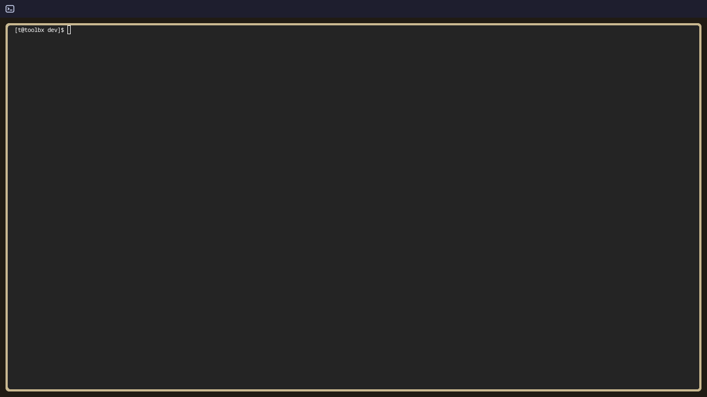

[001-02: bar with a terminal launcher](https://github.com/stackific/stack-os/commit/b15b840ecac5288b67f0ed6fd0807619034329d3)

## Goal

Replace the placeholder bar with the real Stack OS bar and its first widget: a terminal icon that opens the foot terminal when clicked. This serves the milestone's "the terminal icon opens foot" item and half of "a bar showing two icons"; the power icon comes in the next step.

## Context

Step 001-01 built the development loop: `task dev:run` opens Mango in a window with the shell from `src/shell/`, reloading on every save, and `task dev:screenshot` captures it without a display. The shell was a single placeholder file.

Earlier decisions this step implements:

- **The shell is plain QML modules**: one folder per component (the bar, each bar widget), with shared code in its own folders, so a component can later become a plugin without a rewrite.
- **One Quickshell process owns the whole shell**; the bar is its first part.
- **The installed system is minimal**, with no icon theme, so the shell carries its own icons.

## Expectations

Must:

- The bar runs along the top of every monitor, as before.
- A terminal icon sits at the bar's left end; clicking it opens foot.
- The icon is an SVG file in `src/shell/`, not looked up from an icon theme.
- The bar and the terminal button each live in their own folder under `src/shell/`; `shell.qml` only loads the bar.
- The icon changes on hover, so it reads as a button.
- `task dev:screenshot` shows the bar with the terminal icon.

Must not:

- depend on an icon theme or any package not already in the toolbox;
- add the power icon or menu (next step);
- add a plugin layer, settings or theming.

## Prompt

```text title="Prompt" wrap
Implement 001-02: the Stack OS bar with its first widget, a terminal launcher.

Replace the placeholder in `src/shell/` with plain QML modules: `shell.qml` loads the bar from `src/shell/bar/`, one bar per monitor along the top as before, and the bar holds a terminal button from its own folder under `src/shell/`. The button shows a terminal icon from an SVG shipped next to it (no icon theme), highlights on hover, darkens while pressed, and opens foot with Quickshell's detached process launch on click. Drop the "Stack OS (dev)" label; the bar now carries icons.

Keep it minimal: no power menu, settings or theming. Document every file inline, check it with `task dev:screenshot` (add a `RUN=foot` option that opens an app before the shot, so the screenshot shows foot open), and leave the click for the operator to confirm in `task dev:run`.
```

## Outcome

The placeholder is gone; the shell is now plain QML modules. `shell.qml` only loads the bar; the bar (`src/shell/bar/`) draws a 32-pixel strip along the top of every monitor and lays its widgets out left to right, with room kept at the right end for the power menu. Its first widget, the terminal launcher (`src/shell/terminal/`), shows Stack OS's own terminal icon, an SVG shipped next to it, highlights on hover, darkens while pressed and opens foot on click. foot is started detached, so a live reload of the shell does not close it. The "Stack OS (dev)" label was dropped: the bar now carries icons.



## Manual changes

None.

## Result

```
$ task dev:screenshot RUN=foot
output/screenshots/shell.png        # the bar with the terminal icon, foot open below it
```

The shell's log shows `Configuration Loaded` with no QML warnings. In `task dev:run`, hovering highlights the icon and clicking it opens foot (checked by hand). `task lint` passes.

Review: 6 fixed, 5 deferred (see Follow-ups).

## Deviations

- `task dev:screenshot` gained a `RUN=<app>` option that opens an app before the capture.
- Prompts in these entries are now code blocks titled "Prompt", so the docs give each one a copy button.
- Each entry's commit link now opens in a new tab, with a GitHub icon before it and an external-link icon after it.
- The "Stack OS (dev)" label was dropped, because the bar now carries icons; nothing on screen marks a development session until the power menu shows it.
- The repository now ignores `.claude/worktrees/`, where coding agents keep temporary checkouts, so they can never be committed by accident.

## Follow-ups

- Colours and sizes are written into the QML; they move to shared theme values when theming arrives.
- The click opens foot even if foot is missing, silently; a notification on failure can come with notifications.
- When the shell runs as a systemd user service on the installed system, apps it starts sit in the service's control group and would be closed if the shell restarts; launch them in their own scope (`systemd-run --user --scope`) when the service lands (001-04/001-05). The toolbox can't test this: there, `systemd-run --user` reaches the host's service manager.
- Show that a session is a development one (for example in the power menu), since Restart and Shut down only print there (001-03).
- Check the icon stays sharp at fractional scales when per-monitor scale arrives (001-06).
- Step IDs: entries, commits and the PR use `001-02`, while some maintainer notes still say `M1-2`; settle on one form.
