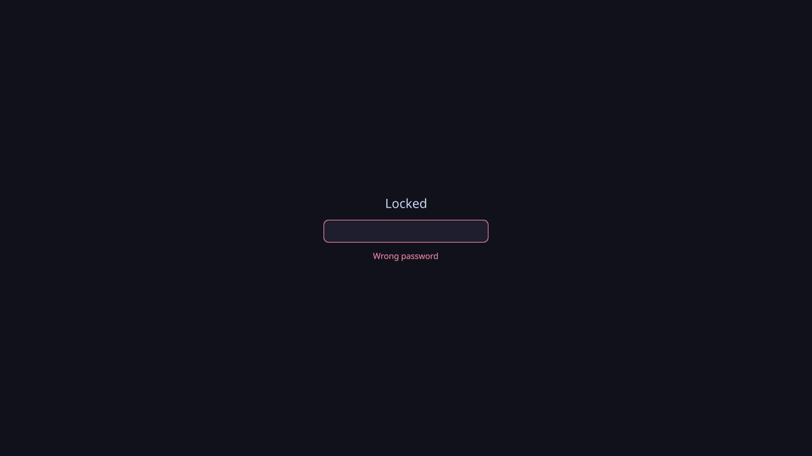

001-03: power menu with the shell's own lock

## Goal

Give the bar its second icon: a power button at the right end that opens a menu with Lock, Log out, Restart and Shut down. Lock is drawn by the Stack OS shell itself and unlocks with the user's password. This serves the milestone's power-menu item and completes "a bar showing two icons".

## Context

Steps 001-01 and 001-02 built the development loop and the bar with a terminal button. Earlier decisions this step implements:

- **The lock is part of the shell**, not a separate program: Quickshell's session lock with a password check through PAM, the system's authentication layer. It is exposed as one call that both the power menu and a keyboard shortcut use.
- **The password check uses Stack OS's own PAM file**, password only (`pam_unix`), shipped under `/usr/share/stack-os/pam/`, so it never waits on a fingerprint reader and never depends on files in `/etc`.
- **Log out quits Mango** (`mmsg dispatch quit`); **Restart and Shut down** use `systemctl reboot` and `systemctl poweroff`.
- **In the development session** (`STACK_OS_DEV=1`), Restart and Shut down only print what they would run, so testing never powers off the developer's machine.

## Expectations

Must:

- A power icon sits at the bar's right end; clicking it opens a menu with Lock, Log out, Restart and Shut down.
- Lock covers every monitor with the shell's lock screen; typing the user's password and pressing Enter unlocks; a wrong password shows an error and keeps it locked.
- Super+L locks too, through the same call as the menu (`qs ipc call lock lock`).
- Log out quits Mango; in the dev session, that closes the nested window.
- In the dev session, Restart and Shut down print the command they would run instead of running it, and the menu says so.
- The PAM file lives in the repository at `src/pam/stack-os-lock`, contains only `pam_unix`, and the shell reads it from `/usr/share/stack-os/pam/` unless the dev session points it at the repository.
- `task dev:screenshot` can show the open menu and the lock screen.

Must not:

- use the system's `login` or `system-auth` PAM stacks;
- run `systemctl reboot` or `poweroff` in the dev session;
- add idle lock, lock before suspend or fingerprint unlock.

## Prompt

```text title="Prompt" wrap
Implement 001-03: the power menu and the shell's own lock.

Add a power button at the bar's right end (own folder under src/shell/, own SVG icon, hover and pressed states like the terminal button). Clicking it opens a small menu below it with Lock, Log out, Restart and Shut down. Log out runs `mmsg dispatch quit`; Restart and Shut down run `systemctl reboot` and `systemctl poweroff`, but when STACK_OS_DEV=1 they only print the command, and the menu shows that it is a development session. The menu also opens through an IPC call (`power toggle`) so it can be scripted.

Add the lock as its own component: Quickshell's WlSessionLock with a lock surface on every monitor (a password field, Enter to unlock, an error on a wrong password) and a PamContext using Stack OS's own password-only PAM file, `src/pam/stack-os-lock` (`auth required pam_unix.so`), read from /usr/share/stack-os/pam/ unless STACK_OS_PAM_DIR points elsewhere. Expose it as `qs ipc call lock lock`; the menu's Lock item and a Super+L binding in the dev Mango config both use that call. `task dev:run` and `task dev:screenshot` point STACK_OS_PAM_DIR at the repository.

Document every file inline, check the menu and the lock with `task dev:screenshot`, and leave unlocking and the menu clicks for the operator to confirm in `task dev:run`.
```

## Outcome

The bar now has its two icons. The power button at the right end (`src/shell/power/`) opens a menu below it with Lock, Log out, Restart and Shut down; in the development session the menu says that Restart and Shut down only print, and they log `dev session, not running: systemctl reboot` (or `poweroff`) instead of running it. Log out quits Mango. `qs ipc call power toggle` opens the menu from a script.

The lock (`src/shell/lock/`) is part of the shell: Quickshell's session lock puts a lock surface with a password field on every monitor, and Enter checks the password through PAM with Stack OS's own one-line file, `src/pam/stack-os-lock` (`auth required pam_unix.so`). A wrong password shows "Wrong password" and keeps the screen locked; any other PAM failure, such as a missing service file, shows "Could not check the password" rather than hanging. The field stays focused, so the next attempt can be typed at once. The menu's Lock item and Super+L both call `qs ipc call lock lock`. Outside the development session the shell reads the PAM file from `/usr/share/stack-os/pam/`; `task dev:run` and `task dev:screenshot` point it at the repository.




## Manual changes

To test unlocking, the operator set a password for their user inside the development toolbox (it had none, so `pam_unix` could not succeed), and `wtype` was installed in the toolbox by hand to type into the headless lock screen.

## Result

```
$ task dev:screenshot RUN='(sleep 2; qs -p "$STACK_OS_SHELL" ipc call power toggle)'
output/screenshots/shell.png        # the menu open below the power icon

$ task dev:screenshot WAIT=18 RUN='(sleep 2; qs -p "$STACK_OS_SHELL" ipc call lock lock; sleep 2;
    wtype -k Shift_L nope -k Return; sleep 5; grim lock-wrong.png;
    wtype -k Shift_L <password> -k Return; sleep 4)'
lock-wrong.png                      # "Wrong password", still locked
output/screenshots/shell.png        # unlocked: the bar again
```

With `STACK_OS_PAM_DIR` pointing at a folder without the service file, Enter shows "Could not check the password" and the field accepts the next attempt.

In `task dev:run` the operator confirmed Super+L, the menu's Lock, unlocking, and Log out closing the nested window. `task lint` passes.

Review: 8 fixed, 5 deferred (see Follow-ups); empty passwords stay rejected, as `pam_unix` without `nullok` rejects them anyway.

## Deviations

- The PAM file is tested only in the development toolbox: decision 03 asked for a test on the image, which does not exist yet; it moves to the image steps (see Follow-ups).
- The milestone's scope dropped building the ISO in a GitHub Action (its last step and "done when" item): an on-demand build workflow was added separately as a CI chore, so this milestone's ISO is built locally only.
- The password field goes read-only while PAM checks a password instead of being disabled: disabling it dropped keyboard focus, so nothing could be typed after a wrong password.
- The development-session prints use `console.info`: Quickshell's default log level hides `console.log`.
- Mango's own startup calls to `systemctl --user` fail in the toolbox (`systemctl: command not found`); that is harmless and keeps the nested session from touching the host's session manager.

## Follow-ups

- The menu closes only through the power icon or an item; close it on Escape and on a click elsewhere.
- The menu's Lock item starts a `qs ipc` process to reach the lock in the same shell; call it directly once a shared service layer exists.
- `power toggle` always opens on the first monitor, and an unplugged monitor's menu state is only cleared by the next toggle.
- The terminal and power buttons repeat the same hover and icon code; factor a shared bar button out before adding a third. Colours repeat across files until theming.
- A live reload while locked rebuilds the lock; decision 03 keeps the lock out of reloads, which the shipped shell (file watcher off) gets with the image steps.
- Add `wtype` to the toolbox image, so lock tests do not need a manual install.
- Test the PAM file on the installed image under Fedora's authselect defaults (001-04/001-05).
- Failed-attempt lockout (`pam_faillock`), idle lock and lock before suspend, as decided.
